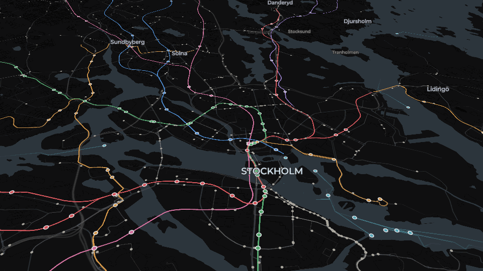
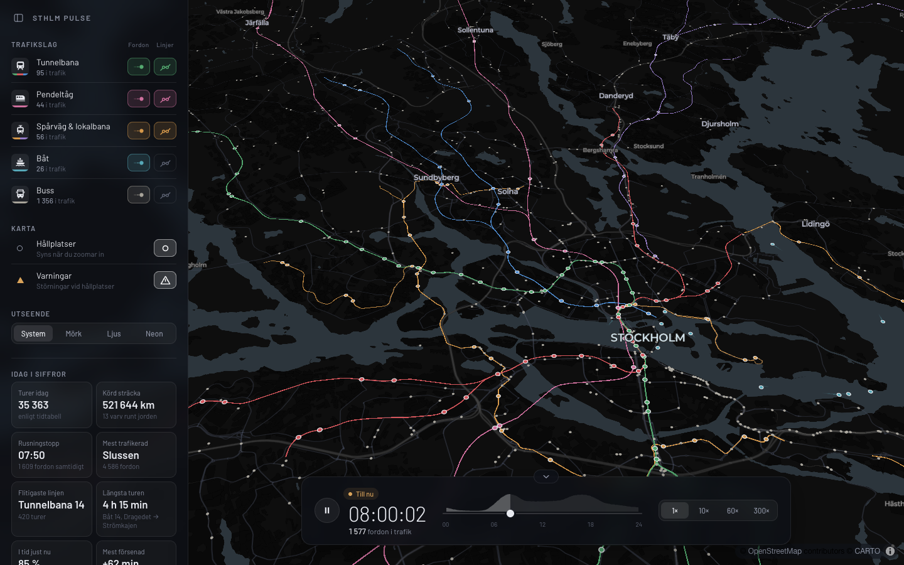

# sthlm pulse

An animated map of Stockholm's public transport. Every metro, commuter train,
tram, bus and ferry in SL's network is a moving dot, from the first departure
of the day to the last.



## Features

- **The whole network, live.** Roughly 35 000 trips a day, drawn along their
  real routes with fading trails. Vehicles stop at every station for a dwell
  time based on SL's GPS data.
- **Realtime delays.** Each trip is shifted by how late it is running, and
  canceled trips disappear.
- **Time travel.** Scrub to any time of day, pause, or play at 10×, 60× or
  300× speed. The activity curve behind the slider shows the rush hours.
- **Vehicles and stations.** Click a vehicle to see its line, next stops and
  delay, and follow it across the map. Click a station to see its next
  departures and how many vehicles pass it today, hour by hour.
- **Disruptions.** Stations with active disruptions get a warning icon.
- **Today in figures.** Trips, distance driven, peak time, the busiest
  station and line, and how much of the traffic is on time right now.
- **Themes.** Dark, light and neon, or follow the system setting.



## How it works

Positions come from the **static timetable**, not from GPS. A trip's stop
times are spread along its route shape, so vehicles glide smoothly between
stops instead of jumping between GPS fixes. Realtime data then only adds a
delay per trip. This also covers the metro and trams, which have no GPS feed.

The server downloads SL's GTFS data once a day, builds the day's network and
serves it to the browser in compact form. The browser loads trips an hour at a
time and animates them with deck.gl on a MapLibre map.

```
apps/
  server/   Node + TypeScript: GTFS download, network builder, realtime feeds, HTTP API
  web/      Vite + TypeScript: the map, MapLibre + deck.gl
```

## Running locally

You need Node 22 or later and a free API key from
[Trafiklab](https://www.trafiklab.se) for **GTFS Regional Static**. A key for
**GTFS Regional Realtime** is optional; without it the map runs on the
timetable alone.

```bash
cp .env.example .env    # add your Trafiklab keys
npm install
npm run dev
```

Open http://localhost:5173. The first start downloads SL's timetable (about
50 MB) and builds the day's network, which takes a minute or so. After that the
data is cached in `data/`.

Other commands:

| Command | What it does |
|---|---|
| `npm run typecheck` | Type checks both apps |
| `npm run build` | Builds the web app into `apps/web/dist` |
| `npm start` | Runs the server, which serves the API and the built site |

## Deploying

The repository includes a Docker setup with [Caddy](https://caddyserver.com)
in front for HTTPS:

```bash
cp .env.example .env    # add your keys, and SITE_ADDRESS once you have a domain
docker compose up -d --build
```

With `SITE_ADDRESS` empty, the site is served over plain HTTP on port 80.
Downloaded data lives in a Docker volume, so it survives restarts and updates.
The server needs about 500 MB of memory.

## API quotas

Trafiklab's free Bronze level allows 60 static downloads per 30 days and about
1 000 realtime requests per day. The server downloads the timetable at most
once a day and only polls the realtime feeds while someone has the site open:
delays at most every 2 minutes and disruptions at most every 15 minutes.
Browsers never talk to Trafiklab directly.

## Data

Timetable and realtime data from SL via [Trafiklab](https://www.trafiklab.se).
Map tiles © [CARTO](https://carto.com/attributions), map data ©
[OpenStreetMap](https://www.openstreetmap.org/copyright) contributors.
